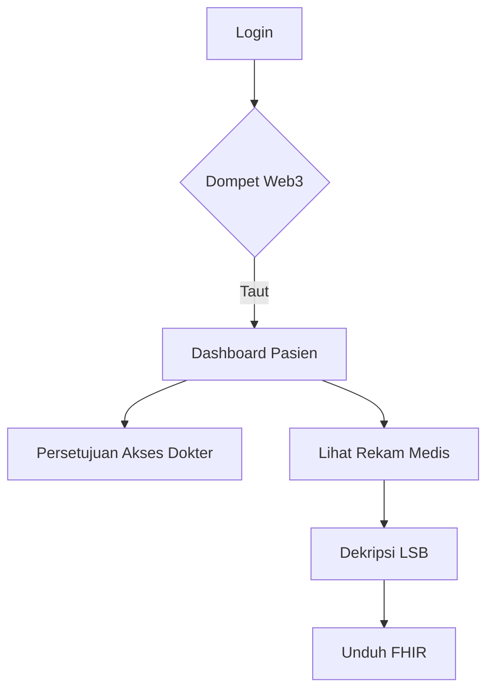
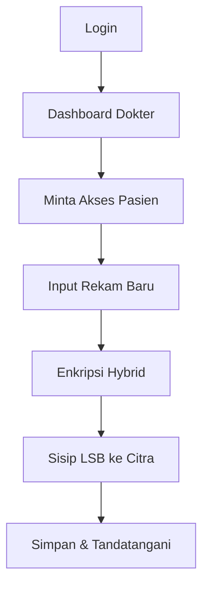
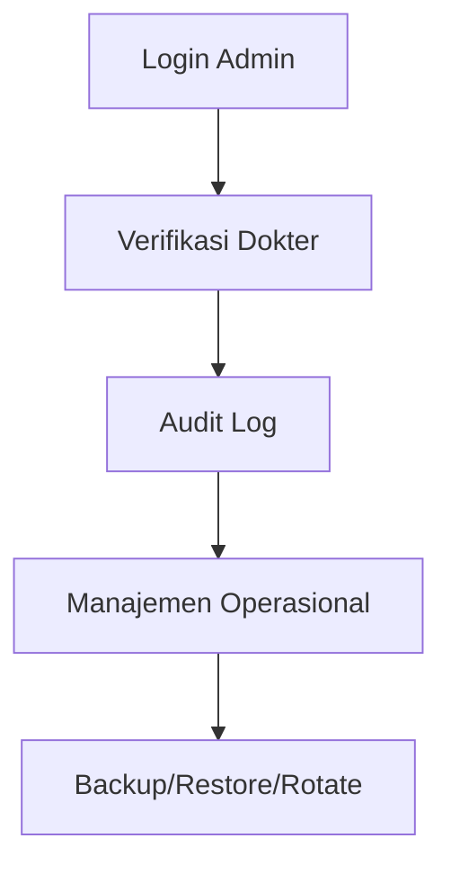
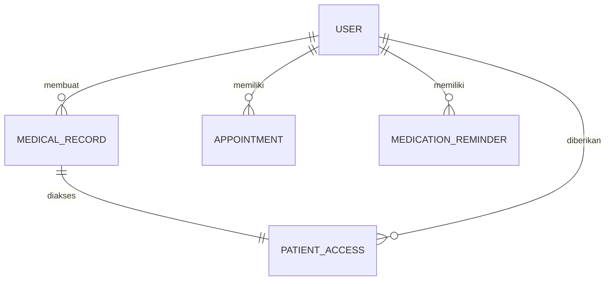

# StegoMed-Web3

Rekam Medis Elektronik (RME) berbasis Streamlit untuk tiga peran (**pasien, dokter, admin**) dengan tiga lapis keamanan:

1. **Enkripsi hybrid MediCrypt**: X25519 + HKDF-SHA256 membungkus kunci data, AES-256-GCM mengenkripsi isi rekam; kolom sensitif di database juga terenkripsi.
2. **Stenografi citra medis**: rekam terenkripsi disembunyikan di LSB piksel citra (PNG/BMP) dengan posisi acak berkunci.
3. **Verifikasi dompet Web3**: fitur steganografi hanya terbuka bila pemilik dompet (MetaMask atau dompet EVM lain) menandatangani pesan SIWE (EIP-4361): gratis, tanpa transaksi, tanpa testnet/mainnet.

> **Status kesiapan.** Kode ini siap untuk **pilot terkontrol/UAT**. Belum tersertifikasi, belum diuji penetrasi, belum ditinjau hukum, dan belum
> terintegrasi SATUSEHAT. Rincian jujur ada di [`docs/KESIAPAN-AUDIT.md`](docs/KESIAPAN-AUDIT.md). Jangan memakai data pasien nyata sebelum
> keputusan organisasi, tinjauan hukum, dan uji independen selesai.

## Fitur per peran

| Peran | Fitur |
| :--- | :--- |
| Semua | Daftar Gmail + password + persetujuan privasi, verifikasi email (OTP), MFA TOTP + kode pemulihan, reset password, batas waktu sesi, pembatas laju, kunci akun, ganti password |
| Pasien | Rekam medis saya (dekripsi, unduh FHIR R4), persetujuan akses dokter (minta/beri/cabut), berbagi dan mencabut akses per rekam (enkripsi ulang), riwayat akses, ekspor data (ZIP), permintaan hak data |
| Dokter | Verifikasi oleh admin, permintaan akses pasien, rekam baru (tanda vital, ICD-10, alergi, obat, addendum, citra medis), riwayat |
| Admin | Verifikasi dokter dengan catatan atau penolakan, antrean permintaan hak data, metadata rekam (tanpa akses isi), audit trail + checkpoint bertanda tangan + ekspor CSV |
| Operator | `tools.manage`: create-admin, reset-mfa, unlock, backup/verify/restore, rotate-master, checkpoint, verify-audit, check-config |
| Opsional | Lab stenografi (PSNR/SSIM, perbandingan hex, kapasitas) untuk kuis dan riset; nonaktif di produksi |

## Alur Kerja (Flowchart)

### 1. Peran Pasien


### 2. Peran Dokter


### 3. Peran Admin


## ERD (Entity Relationship Diagram)

*(Catatan: User adalah entitas utama mencakup pasien, dokter, admin)*

---


## Menjalankan lokal (pengembangan)

```bash
python -m venv venv
source venv/bin/activate          # Windows: venv\Scripts\activate
pip install -r requirements.txt
cp .env.example .env              # opsional
streamlit run app.py              # http://localhost:8501
```
Mode pengembangan (bawaan): dompet demo aktif (tanpa MetaMask), dokter langsung disetujui, OTP email tampil di "Kotak masuk pengembangan" pada halaman login.

**Coba cepat:** daftar pasien → tautkan `pasien-demo` di tab *Dompet demo* → keluar → daftar dokter → *Pasien saya* → tautkan `dokter-demo`, minta akses dengan email pasien →
keluar → pasien menyetujui di *Akses dokter* → dokter membuat rekam di *Rekam medis baru* → pasien membukanya di *Rekam medis saya*.
Admin: isi `ADMIN_EMAILS` dengan Gmail Anda lalu daftar dengan email itu, atau `python -m tools.manage create-admin ...`.

## Produksi (Docker)

```bash
cp .env.production.example .env.production      # isi SEMUA nilai
docker compose --env-file .env.production up -d --build
docker compose exec app python -m tools.manage check-config
docker compose exec app python -m tools.manage create-admin --email admin@gmail.com --name "Nama Admin"
```
Mode produksi (`APP_ENV=production`) **menolak start** bila dompet demo aktif, dokter auto-approve, master key kosong/pendek, SQLite, bukan HTTPS, SMTP kosong,
ADMIN_EMAILS kosong, atau MFA admin/dokter tidak wajib. Backup, rotasi kunci, pemantauan, dan insiden: [`docs/RUNBOOK-OPERASI.md`](docs/RUNBOOK-OPERASI.md).
(Berkas Docker belum dapat diuji build di lingkungan pembuatnya; jalankan `docker compose build` dan tinjau hasilnya.)

## Konfigurasi utama

| Variabel | Fungsi | Bawaan dev / prod |
| :--- | :--- | :--- |
| `APP_ENV` | `development` atau `production` | development |
| `MEDICRYPT_MASTER_KEY` (`_OLD`) | Rahasia utama (dan kunci lama saat rotasi), ≥ 32 karakter | file otomatis / **wajib** |
| `DATABASE_URL` | PostgreSQL atau SQLite | SQLite / PostgreSQL |
| `ADMIN_EMAILS` | Email admin (pisah koma) | kosong / wajib |
| `ALLOW_DEV_WALLET`, `AUTO_APPROVE_DOCTORS` | Kemudahan uji | 1 / **0** |
| `REQUIRE_EMAIL_VERIFICATION`, `REQUIRE_MFA_ROLES` | OTP email, MFA wajib per peran | 0, kosong / 1, `admin,doctor` |
| `MAIL_BACKEND`, `SMTP_*` | Pengiriman OTP | console / smtp |
| `SESSION_IDLE_MINUTES`, `SESSION_MAX_HOURS`, `STEGO_UNLOCK_MINUTES` | Batas waktu | 120, 8, 30 / 20, 8, 30 |
| `ENABLE_LAB` | Lab stenografi | 1 / 0 |
| `TRUST_PROXY_HEADERS` | Percayai X-Forwarded-For (hanya di belakang proxy) | 0 |

Daftar lengkap: `.env.example` (dev) dan `.env.production.example` (produksi).

## Tes dan CI

```bash
pip install -r requirements-dev.txt -c constraints.txt
pytest -q                          # 74 tes: unit, end-to-end UI, backup/restore, rotasi kunci, migrasi
```
CI (`.github/workflows/ci.yml`): pytest (Python 3.11/3.12), bandit, pip-audit, build Docker. Dependabot mingguan. Versi dependensi terkunci di `constraints.txt`.

## Struktur folder

```text
app.py  config.py  models.py  Dockerfile  docker-compose.yml  constraints.txt  requirements*.txt
components/   steganography.py (LSB, PSNR/SSIM, hex) · web3_auth.py + web3_frontend/ (komponen MetaMask)
utils/        auth · totp · mailer · fieldcrypt · crypto_utils · record_service · fhir · clinical · migrations · db_helper · access · web3_utils · clientinfo · principal
views/        login · wallet · security · dashboard · doctor · consent · records · patient_rights · verify · admin · lab · ui
tools/        manage.py (CLI operasional)
deploy/       Caddyfile
docs/         ARSITEKTUR-DAN-ANCAMAN · RUNBOOK-OPERASI · KEBIJAKAN-KEAMANAN-TEMPLAT · PEMBERITAHUAN-PRIVASI-TEMPLAT · PANDUAN-PENGGUNA · KESIAPAN-AUDIT
tests/        test_foundation · test_accounts_security · test_clinical_sharing · test_audit_rights · test_ops_tools · test_app_flow · test_core · test_auth
```

## Batasan penting

- **Bukan enkripsi ujung-ke-ujung:** server memegang kunci privat pengguna terbungkus; master key + database bocor = data terbuka. Master key hilang = data hilang.
- **LSB rapuh** terhadap kompresi lossy dan pengeditan citra; simpan stegotext hanya sebagai PNG/BMP dan jangan kirim lewat layanan yang mengompres gambar.
- Pencabutan akses berlaku untuk file terbaru; dokter yang sudah menyimpan salinan file saat akses aktif masih memegangnya.
- Verifikasi STR dokter manual oleh admin; belum ada tanda tangan elektronik tersertifikasi; ekspor FHIR bersifat generik (bukan profil SATUSEHAT).
- Streamlit berjalan satu proses per instans; belum diuji beban. Smart wallet (ERC-1271) tidak didukung.
- Format enkripsi rancangan sendiri dari primitif standar dan belum ditelaah ahli kriptografi independen.

## Lisensi
MIT, lihat [LICENSE](LICENSE).
